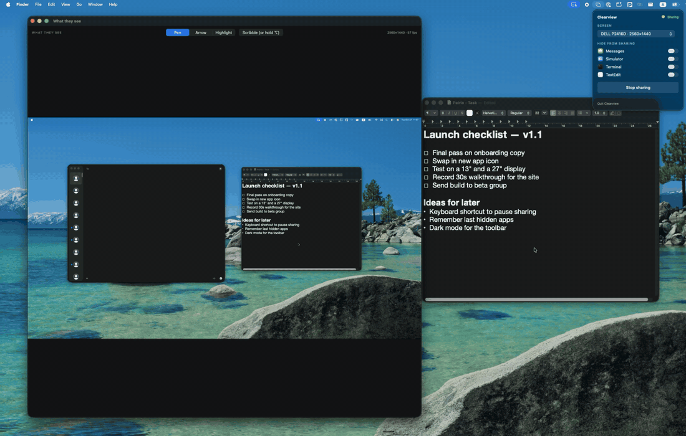
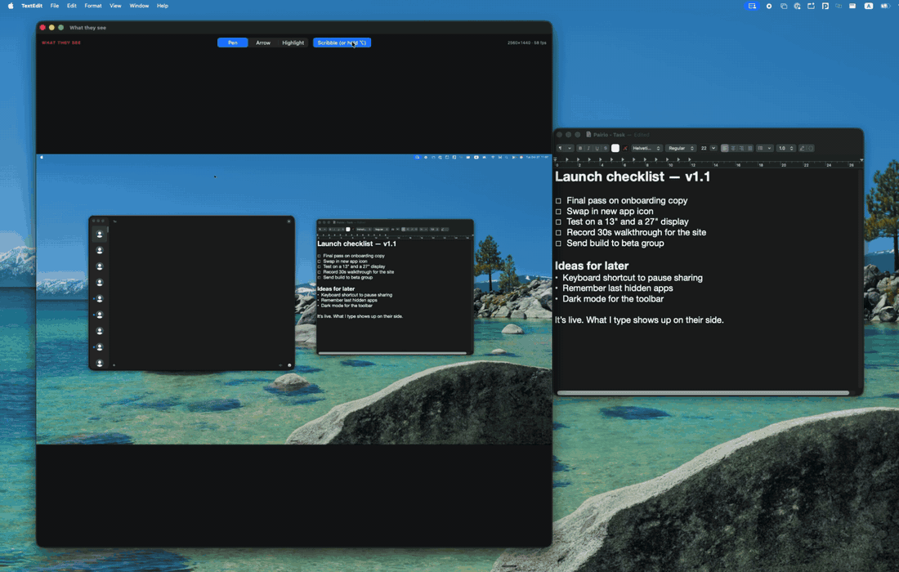

# Clearview

A small macOS proof of concept for sharp, private screen sharing, built with
ScreenCaptureKit, Metal and SwiftUI. It runs on one Mac: the "What they see"
window shows exactly what a teammate on the other end of a call would get.

**Live.** Typing on the shared screen shows up in "What they see" straight away.



**Draw.** Pen, arrow and highlighter, mirrored onto the real screen, fading after a few seconds.



**Hide apps.** Messages, then TextEdit, drop out of the share while they stay open and keep changing.


## What it does

- **Share a display at full Retina resolution.** ScreenCaptureKit captures at
  the display's native pixel size (BGRA, sRGB, up to 60 fps). Frames go
  straight from IOSurface-backed buffers into a Metal texture that wraps the
  same memory, with no CPU copy.
- **Hide apps from the share.** Switch off any app in the menu bar panel and
  its windows disappear from the stream at once, without restarting it
  (`SCContentFilter(display:excludingApplications:exceptingWindows:)` plus
  `SCStream.updateContentFilter`). Clearview always leaves itself out, so the
  viewer never captures its own window.
- **Draw on the shared screen.** Hold ⌥ (or turn on Scribble) and drag in
  "What they see" to draw with a pen, an arrow or a highlighter. Strokes show
  in the viewer and on the real screen through a transparent, click-through
  overlay, then fade after a few seconds. Points are stored normalised, so a
  stroke lands in the same place at any window size.
- **A live readout** of capture resolution and frames per second.
  ScreenCaptureKit only sends a frame when the screen changes, so a still
  screen reads low.

## What it leaves out

Calls, networking (WebRTC), encoding, remote control, audio and video chat.
This is the capture, privacy and drawing side only.

## Run it

Needs macOS 15 or later and Xcode 26 with the Metal toolchain (Xcode offers it, or run `xcodebuild -downloadComponent MetalToolchain`).

```sh
brew install xcodegen
xcodegen generate
open Clearview.xcodeproj
```

Run the Clearview scheme, then click the menu bar icon and press **Share**.
The first time, macOS asks for Screen Recording permission (System Settings ›
Privacy & Security › Screen & System Audio Recording); allow it and reopen the
app. Set your own team in `project.yml` to sign it.

Tests: `xcodebuild test -scheme Clearview -destination 'platform=macOS'`

## How it fits together

Plain SwiftUI with `@Observable` models, which is the pattern Apple's own
samples use. `CaptureModel` and `ScribbleStore` hold the state and are shared
through the environment. There is no ViewModel layer: at this size, extra
layers would add files without adding clarity.

Two paths run through it:

- **Frames.** `SCStream` → `FrameReceiver` (on a background queue, keeps only
  the newest frame behind a lock) → `FrameRenderer` (Metal, pulls that frame
  on each display refresh) → `FrameView`. Frames never pass through SwiftUI
  state, so the views don't re-render 60 times a second.
- **Drawing.** Drag in `ViewerView` → `ScribbleStore` (points normalised to
  0…1) → `StrokesCanvas`. The same canvas draws in the viewer and in the
  overlay window on the real screen, so both sides always match.

In a larger app, the first change would be to put the capture behind a
protocol, so the models can be tested without a real display.

## Layout

| File | Role |
|---|---|
| `CaptureModel.swift` | Display and app lists, content filter, stream lifecycle |
| `FrameReceiver.swift` | Receives stream frames, keeps the newest, counts fps |
| `FrameRenderer.swift` / `Shaders.metal` | Metal view and shader that draw the newest frame, aspect-fit |
| `ScribbleStore.swift` | Shared strokes, tools and fading |
| `StrokesCanvas.swift` | Draws strokes; used by the viewer and the overlay |
| `OverlayController.swift` | Transparent window over the shared display |
| `ViewerView.swift` / `PanelView.swift` | "What they see" window and menu bar panel |
| `Geometry.swift` | Aspect-fit and normalised point mapping |

Built by Blain Ellis.
